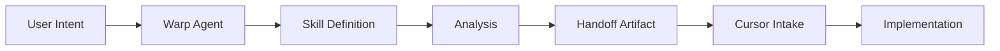
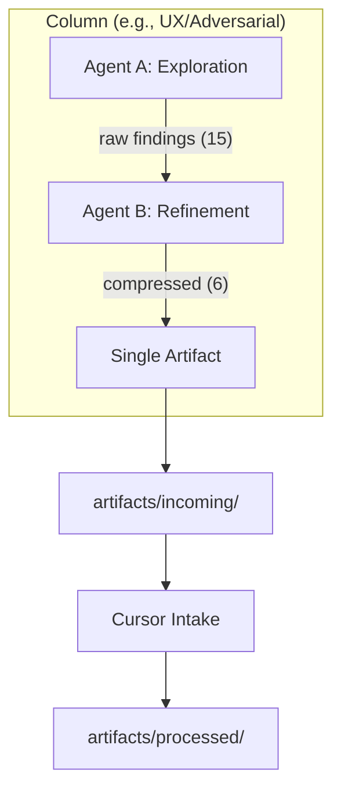

# Agent Skills Toolbox

A production-grade repository of reusable AI agent skills designed for **Warp-to-Cursor workflows**. This system enables structured, high-signal analysis through executable agent roles that produce standardized handoff artifacts.

[](https://github.com/ianmxaof/agent-skills)

---

## Table of Contents

- [What Is This?](#what-is-this)
- [Key Features](#key-features)
- [Quick Start](#quick-start)
  - [For Warp Users](#for-warp-users)
  - [Setting Up Your Project](#setting-up-your-project)
- [How It Works](#how-it-works)
  - [Single Skill Invocation](#single-skill-invocation)
  - [Column Pattern (2-Agent Pipeline)](#column-pattern-2-agent-pipeline)
  - [Cursor Intake](#cursor-intake)
- [Available Skills](#available-skills)
- [Governance System](#governance-system)
- [Autonomous Attention](#autonomous-attention)
- [Project Structure](#project-structure)
- [Key Documents](#key-documents)
- [Creating New Skills](#creating-new-skills)
- [Contributing](#contributing)

---

## What Is This?

This repository contains **executable agent roles** ("skills") that can be invoked by Warp agents to:

- Analyze codebases for architecture, security, performance, and UX issues
- Generate structured findings with severity rankings
- Produce standardized handoff reports for implementation in Cursor
- Self-improve through feedback loops and effectiveness tracking

**Key Characteristics:**

| Characteristic | Description |
|----------------|-------------|
| **Infrastructure** | Toolchain components, not prompt snippets |
| **Portable** | Copy into any project, works across codebases |
| **Structured** | Skills produce standardized handoff artifacts |
| **Composable** | Skills work together in chains and columns |
| **Self-Governing** | Built-in risk assessment and attention allocation |
| **Observable** | Optional execution logging for improvement |

---

## Key Features

### 1. Two Invocation Modes

| Mode | Pattern | Use When |
|------|---------|----------|
| **Direct** | `"Assume {skill-name} and analyze {target}"` | You know exactly which skill you want |
| **Intent-Based** | `"Resolve and execute the appropriate skill for: {intent}"` | Let the system find the right skill |

### 2. Column Pattern (2-Agent Pipeline)

Higher signal quality through exploration + refinement:

```
Agent A (Exploration) → 15 raw findings
        ↓
Agent B (Refinement) → 6 high-quality findings
        ↓
Single artifact → Cursor intake
```

### 3. Governance Layer

- **Risk Assessment**: Automatically determines analysis depth
- **Strategic Governor**: Throttles/escalates based on findings
- **Attention Budget**: Prevents over-analysis

### 4. Autonomous Attention

- **Health Assessment**: "What needs my attention?" without specifying
- **Readiness Certification**: Ship/no-ship decisions with evidence
- **Change Amplification**: Detect high-leverage changes

---

## Quick Start

### For Warp Users

#### Step 1: Set Up Artifacts Directory

```bash
mkdir -p .agent-skills/artifacts/incoming
mkdir -p .agent-skills/artifacts/processed
```

#### Step 2: Invoke a Skill (Direct Mode)

```
warp> Assume the architecture-review skill and analyze this codebase
```

#### Step 3: Or Use Intent-Based Resolution

```
warp> Resolve and execute the appropriate skill for: finding security vulnerabilities
```

#### Step 4: Process Results in Cursor

```
cursor> Run the standard artifact intake and integration pass
```

### Setting Up Your Project

1. **Copy project structure template:**
   ```bash
   cp -r templates/project-structure/.agent-skills .agent-skills
   ```

2. **Create skill map:**
   ```bash
   cp templates/skill-map-template.yaml .agent-skills/skill-map.yaml
   ```

3. **Edit skill-map.yaml** with your project details:
   ```yaml
   project:
     name: your-project-name
     type: react-app | cli-tool | api-service
     risk-profile: low | medium | high
   
   universal-skills:
     - architecture-review
     - dependency-health-check
     - test-coverage-gap-finder
   ```

4. **Validate skill map:**
   ```
   warp> Assume skill-map-validator and validate this project's skill map
   ```

---

## How It Works

### Single Skill Invocation



**Example:**
```
warp> Assume the dependency-health-check skill and analyze this project

# Warp loads skills/security/dependency-health-check.md
# Executes analysis per skill behavioral rules
# Produces structured artifact in artifacts/incoming/
```

### Column Pattern (2-Agent Pipeline)

For high-stakes analysis, use the column pattern:



#### Agent A Invocation (Exploration)

```markdown
You are Agent A (Exploration Layer) in a 2-agent column.

**Skill:** `adversarial-ui-tester`
**Target:** the checkout flow

Operating Posture:
- Maximize coverage
- Allow mess (comprehensiveness > polish)
- Do NOT self-censor findings
- Do NOT deduplicate (that's Agent B's job)

Your output goes to Agent B. Do NOT write artifacts.
```

#### Agent B Invocation (Refinement)

```markdown
You are Agent B (Refinement Layer) in a 2-agent column.

**Input:** [Paste Agent A's output here]

Your Job:
1. Deduplicate — Merge overlapping findings
2. Rank — Assign severity (critical/high/medium/low)
3. Clarify — Rewrite for actionability
4. Package — Write ONE artifact to artifacts/incoming/

You are a filter, not a second thinker.
```

#### When to Use Columns

| Use Columns | Use Single Skills |
|-------------|-------------------|
| Pre-release audits | Quick checks |
| Complex domain analysis | Low-stakes review |
| High-stakes changes | Time-constrained |
| When burned by false negatives | When you trust skill output |

### Cursor Intake

After Warp produces artifacts, switch to Cursor:

> **"Run the standard artifact intake and integration pass."**

Cursor will:
1. Read all artifacts from `artifacts/incoming/`
2. Parse findings and priorities
3. Synthesize across multiple artifacts (detect convergence/conflicts)
4. Produce a concrete action plan
5. Move processed artifacts to `artifacts/processed/`

---

## Available Skills

### By Risk Tier

| Tier | Purpose | Skills |
|------|---------|--------|
| **Tier 1** (Existential) | Philosophy, privacy, performance | `philosophy-compliance-enforcer`, `privacy-tier-auditor`, `performance-budget-guardian`, `state-invariant-validator`, `capture-surface-focus-auditor` |
| **Tier 2** (System Health) | Migrations, accuracy, drift | `dependency-health-check`, `architectural-drift-detector`, `adversarial-ui-tester`, `database-migration-safety-checker`, `rac-accuracy-evaluator`, `variant-tree-explosion-detector`, `toast-notification-spam-detector` |
| **Tier 3** (Long-term Quality) | Testing, docs, architecture | `test-coverage-gap-finder`, `bundle-size-analyzer`, `api-boundary-validator`, `project-structure-analyzer`, `architecture-review`, `failure-mode-simulator`, `ux-copy-neutrality-checker`, `documentation-drift-detector` |
| **Meta** | Skill management | `skill-router`, `skill-health-check`, `skill-gap-detector`, `skill-effectiveness-analyzer`, `column-router`, `strategic-governor`, `health-assessor`, `readiness-certifier`, `refinement-layer`, `handoff-quality-validator`, `skill-map-validator`, `change-amplification-detector` |

### By Category

| Category | Skills |
|----------|--------|
| **Analysis** | `project-structure-analyzer`, `documentation-drift-detector` |
| **Architecture** | `architecture-review`, `architectural-drift-detector` |
| **API** | `api-boundary-validator` |
| **Database** | `database-migration-safety-checker` |
| **Performance** | `bundle-size-analyzer`, `performance-budget-guardian`, `capture-surface-focus-auditor` |
| **Security** | `dependency-health-check`, `privacy-tier-auditor` |
| **Testing** | `adversarial-ui-tester`, `test-coverage-gap-finder`, `failure-mode-simulator` |
| **UX** | `ux-copy-neutrality-checker` |
| **State** | `state-invariant-validator` |
| **Philosophy** | `philosophy-compliance-enforcer` |

See `skills-index.md` for complete skill documentation.

---

## Governance System

### Risk Assessment Flow

```
warp> Assess risk and plan columns for: refactoring checkout validation
```

The column-router produces:

```yaml
risk_assessment:
  tier: medium
  failure_cost:
    level: medium-high
    highest_concern: trust_impact

column_plan:
  recommended_columns:
    - name: ux-adversarial
      reason: "User-facing checkout change"
    - name: correctness
      reason: "Functional behavior change"
```

### Risk Tiers

| Tier | Columns | Refinement | Use When |
|------|---------|------------|----------|
| Trivial | 0 | None | Config, copy, styling |
| Low | 1 | Light | Reversible, bounded |
| Medium | 2-3 | Normal | Functional changes |
| High | 4 | Strict | Irreversible, sensitive |
| Critical | 4+ | Strict + Proofs | Payment, auth, data |

### Strategic Governor

During execution, the governor:
- **Throttles**: Excessive analysis for risk tier
- **Escalates**: Critical findings in low-risk assessments
- **Halts**: Missing proofs or conflicts

---

## Autonomous Attention

### Health Assessment (Intentless)

```
warp> Assess the health of this project
```

The health-assessor will:
- Load your skill-map contract
- Detect recent changes across surfaces
- Calculate concern scores
- Recommend specific skills to run
- Report "no action needed" for clean surfaces

### Readiness Certification

```
warp> Certify readiness for production
```

Produces:
- **READY**: Safe to ship
- **CONDITIONAL**: Issues with documented tradeoffs
- **BLOCKED**: Hard blockers that must be addressed

### Change Amplification

```
warp> Check amplification for changes to TEMPLATE.md
```

Identifies high-leverage changes (templates, governance files) that deserve extra scrutiny.

---

## Project Structure

```
agent-skills/
├── README.md                     # This file
├── TEMPLATE.md                   # Skill creation template
├── SKILL-SELECTOR.md             # Decision tree for choosing skills
├── SKILL-MAP.mmd                 # Visual skill relationships
├── skills-index.md               # Complete skill inventory
│
├── skills/                       # All skill definitions
│   ├── analysis/                 # Discovery and mapping
│   ├── api/                      # API boundary validation
│   ├── architecture/             # Architecture review
│   ├── database/                 # Database migrations
│   ├── failure-modes/            # Failure simulation
│   ├── meta/                     # Meta-skills (routing, governance)
│   ├── notifications/            # Notification patterns
│   ├── performance/              # Performance analysis
│   ├── philosophy/               # Philosophy compliance
│   ├── rac/                      # RAC accuracy
│   ├── security/                 # Security and dependencies
│   ├── state/                    # State management
│   ├── testing/                  # Testing and validation
│   ├── ux/                       # UX analysis
│   └── variants/                 # Variant management
│
├── templates/                    # Templates for skills and columns
│   ├── agent-a-instruction-template.md
│   ├── agent-b-instruction-template.md
│   ├── column-configuration-template.yaml
│   ├── skill-map-template.yaml
│   └── project-structure/        # Project setup template
│
├── protocols/                    # Communication contracts
│   ├── handoff-protocol.md       # Artifact structure
│   ├── attention-autonomy-protocol.md
│   └── lessons-learned-protocol.md
│
├── meta/                         # System rules and policies
│   ├── anti-patterns.md          # Learned regrets
│   ├── artifact-policy.md        # Artifact lifecycle
│   ├── failure-cost-model.md     # Cost assessment axes
│   ├── governor-rules.md         # Throttle/escalate triggers
│   ├── risk-tiers.md             # Risk tier definitions
│   ├── skill-lifecycle.md        # Promotion/demotion
│   ├── skill-scope-policy.md     # Three-tier architecture
│   ├── skill-trust-scores.yaml   # Trust metrics
│   ├── tag-taxonomy.md           # Tag naming conventions
│   └── taste-profile.yaml        # Preferences and biases
│
├── docs/                         # User documentation
│   ├── warp-integration-guide.md # How Warp uses skills
│   ├── cursor-intake-protocol.md # Standard Cursor command
│   ├── column-pattern-guide.md   # 2-agent pipeline
│   ├── column-examples.md        # Worked examples
│   ├── agent-invocation-guide.md # Detailed invocation
│   ├── migration-guide.md        # Setup instructions
│   └── self-improvement-mechanism.md
│
├── skill-chains/                 # Pre-configured sequences
│   └── full-codebase-audit-v1.yaml
│
├── profiles/                     # Project-type profiles
│   └── react-spa.md
│
├── tests/                        # Validation framework
│   ├── routing-validation.md
│   └── routing-observations.md
│
└── .agent-skills/                # Project-specific config
    ├── skill-map.yaml            # Project contract
    └── artifacts/
        ├── incoming/             # New artifacts
        └── processed/            # Completed artifacts
```

---

## Key Documents

### Getting Started
| Document | Purpose |
|----------|---------|
| `docs/warp-integration-guide.md` | How to use Warp with agent-skills |
| `docs/cursor-intake-protocol.md` | Standard Cursor intake command |
| `docs/migration-guide.md` | Setting up your project |

### Column Pattern
| Document | Purpose |
|----------|---------|
| `docs/column-pattern-guide.md` | Complete column documentation |
| `docs/column-examples.md` | Worked examples with artifacts |
| `templates/agent-a-instruction-template.md` | Agent A (exploration) |
| `templates/agent-b-instruction-template.md` | Agent B (refinement) |

### Governance
| Document | Purpose |
|----------|---------|
| `meta/risk-tiers.md` | Risk tier definitions |
| `meta/governor-rules.md` | Throttle/escalate triggers |
| `meta/failure-cost-model.md` | Cost assessment axes |
| `meta/anti-patterns.md` | Learned regrets |

### Skill Development
| Document | Purpose |
|----------|---------|
| `TEMPLATE.md` | Skill creation template |
| `meta/skill-scope-policy.md` | Three-tier architecture |
| `meta/skill-lifecycle.md` | Promotion criteria |
| `meta/tag-taxonomy.md` | Tag naming conventions |

---

## Creating New Skills

### 1. Determine Scope

| Scope | Location | Use When |
|-------|----------|----------|
| **core** | `skills/{category}/` | Works on any project |
| **domain** | `skills/domains/{domain}/` | Technology-specific |
| **project** | `.agent-skills/skills/project/` | Project-specific only |
| **meta** | `skills/meta/` | Operates on skills themselves |

### 2. Create Skill File

```bash
cp TEMPLATE.md skills/category/new-skill.md
```

### 3. Fill Required Sections

```yaml
---
type: skill-definition
name: new-skill-name
scope: core | domain | project | meta
tier: 1 | 2 | 3 | meta
lifecycle: experimental
execution-modes:
  - full-scan
  - incremental
  - targeted
tags:
  - surface-tag
  - action-tag
  - domain-tag
---
```

### 4. Validate

```
warp> Assume skill-health-check and validate skills/category/new-skill.md
```

---

## Contributing

### Skill Development Guidelines

1. Follow `TEMPLATE.md` structure exactly
2. Include all required YAML front matter fields
3. Document anti-patterns and limitations
4. Test with real scenarios before promotion
5. Start with `lifecycle: experimental`

### Skill Retirement

Skills are deprecated when:
- Used < 3 times in 6 months
- Superseded by better skill
- Technology becomes obsolete

See `meta/promotion-criteria.md` for full lifecycle details.

---

## License

MIT License - See LICENSE file for details.

## Support

- **GitHub Issues**: [github.com/ianmxaof/agent-skills/issues](https://github.com/ianmxaof/agent-skills/issues)
- **Documentation**: See `docs/` directory

---

*Last updated: January 2026*
